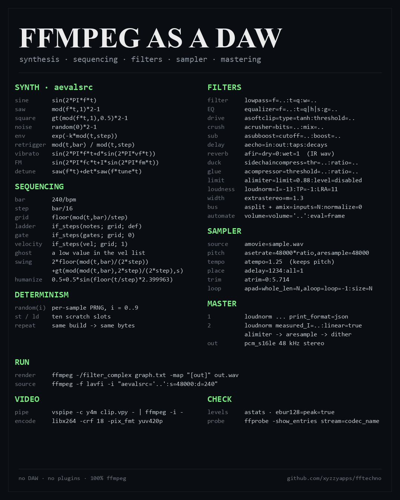

# fftechno

[](https://www.deepseek.com/)



**Make music with ffmpeg.** A song is a folder of Markdown; the Python build turns it
into a mastered WAV and, when the song has a `video.md`, a beat-locked video. There is
no DAW, no plugin and no MIDI.

- **Synth songs** build every sound from `aevalsrc` expressions.
- **Sample songs** play real audio files through an `amovie` sampler.
- **Every build is reproducible** and every render is kept (`techno_v2.wav`, ...).

[Example songs](#example-songs) · [Specification](SPEC.md) · [Song walkthrough](docs/SONG_EXPLANATION.md) · [ffmpeg synthesis tutorial](docs/AEVAL_TUTORIAL.md)

## Quick start

Requirements: **Python 3.10+**, **ffmpeg 9+** and `ffprobe` on `PATH`.

Instrumental songs need no Python packages:

```powershell
git clone https://github.com/xyzzyapps/fftechno
cd fftechno
python -m fftechno audio --song minimal
ffplay output/minimal/techno.wav
```

`basement` and `hardgroove` have a TTS vocal stem, so they also need the voice
packages installed below.

For video and voice, create the venv once:

```powershell
python -m venv .venv
.venv\Scripts\pip install vapoursynth numpy vs-placebo onnxruntime
.venv\Scripts\pip install kittenml soundfile huggingface_hub phonemizer espeakng_loader
.venv\Scripts\python -m vapoursynth config

# subject matting: put the RVM model in tools\rvm\
# https://github.com/PeterL1n/RobustVideoMatting/releases/download/v1.0.0/rvm_mobilenetv3_fp32.onnx

.venv\Scripts\python -m fftechno all --song basement
```

Run commands from the repo root: sample paths are relative to it. `all` renders the
audio, the picture loop and the video. A single 4-minute synth song takes a few
minutes; the full nine-song set is longer.

## Songs

| Song | Style | Length | Sounds | Visual |
|------|-------|--------|--------|--------|
| `basement` | jungle techno | 155 BPM, 4:00 | 17 synth instruments + TTS voice | `outline` |
| `hardgroove` | hardgroove techno | 140 BPM, 4:00 | 12 synth instruments + TTS voice | `edge` |
| `minimal` | minimal techno | 100 BPM, 3:00 | 7 synth instruments | `photo` + `squares, grain` |
| `triphop` | trip hop | 84 BPM, 4:00 | 11 synth instruments, instrumental | none |
| `triphop_beat` | trip-hop scratch | 88 BPM, 21.8 s | 3 synth instruments, instrumental | none |
| `triphop_samples` | trip hop | 84 BPM, 3:48.6 | 4: Amen break, sub, electric piano, vinyl | cover video (separate) |
| `psych` | 1960s psychedelic rock | 110 BPM, 4:00 | 13 synth instruments, instrumental | none |
| `stoner` | stoner rock | 76 BPM, 4:00 | 11 synth instruments, instrumental | none |
| `stoner_samples` | sampled stoner rock | 80 BPM, 4:00 | 10 sampled drums, guitar and bass | none |

A song is just a folder under `songs/`. `song.md` and `sounds.md` are required;
`vocals.md` and `video.md` are optional. Without them the song is instrumental with
no video.

## Commands

All commands run from the repo root. `S` is a folder name under `songs/`; the
default is `basement` (`config.DEFAULT_SONG`).

| Command | What it does | Writes |
|---------|--------------|--------|
| `python -m fftechno audio --song S [--out DIR]` | stems -> mix -> master | `<out>/S/techno.wav` (default `output/`) |
| `python -m fftechno synth --song S` | regenerate the ffmpeg graphs from `sounds.md` | `filters/S/*.txt` (generated, gitignored) |
| `python -m fftechno samples` | download and normalise the sample sets | `samples/` |
| `python -m fftechno girl --song S` | build the picture loop only | `output/S/girl_loop.mp4` |
| `python -m fftechno video --song S` | render and mux the VapourSynth video | `output/S/techno_visualizer.mp4` + 720p |
| `python -m fftechno all --song S` | audio, then picture loop, then video | all of the above |
| `python -m fftechno swap --song S` | put the current master into the existing MP4 | video copied, no re-render |
| `python -m fftechno boost 2.0 --song S` | re-level the audio in the existing MP4s | video copied, no re-render |

Useful flags:

| Flag | Used by | Effect |
|------|---------|--------|
| `--safe` | `audio`, `all` | extra ear-protection limiter (about -6 dBFS ceiling) |
| `--out DIR` | `audio` | write under `DIR` instead of `output/` (e.g. `--out out2`) |
| `--tts kitten\|piper\|flite` | `audio`, `all` | pick the vocal engine |
| `--look edge\|pollock\|outline\|photo` | `girl`, `video`, `all` | override the picture source |
| `--fx squares,grain` | `video`, `all` | override the effect chain |
| `--mode reset\|trail\|build` | `girl`, `video`, `all` | Pollock paint accumulation |
| `--static` | `video`, `all` | render one frozen frame |
| `--force` | `samples` | re-download and re-normalise everything |

`python -m fftechno <command> -h` prints the full option list.

**Nothing is overwritten.** A second build writes `techno_v2.wav`,
`techno_visualizer_v2.mp4`, and so on. `swap` and `boost` automatically pick the
newest matching file. The build lock (`<out>/S/logs/.build.lock`) stops two builds
from writing the same song at once.

For a clean verification run that leaves `output/` alone, use the output override:

```powershell
python -m fftechno audio --song minimal --out out2
# -> out2/minimal/techno.wav, stems/ and logs/
```

## How a song works

```
songs/<song>/
  song.md       arrangement and mix: tempo, length, sections, pan, effects
  sounds.md     instrument recipes: one row per sound, plus optional samplers
  vocals.md     optional TTS engine, voice, treatment parameters and phrase times
  video.md      optional picture source, size, look and effect chain

templates/      one ffmpeg schematic per instrument, with {{placeholders}}
filters/<song>/ the generated graphs written by `synth` / `audio` (gitignored)
```

`templates/` is the schematic; `sounds.md` fills in the numbers. Templates are
multiline for readability: blank lines and full-line `#` comments are ignored, and
the remaining lines are joined with spaces before substitution. Break lines at `;`,
`,` or before a `+`, never inside a token.

A minimal `song.md` arrangement looks like this:

```markdown
bpm: 100
bars: 75
fade_bars: 7
sidechain_key: kick
low_bus: bass

## Stems
| stem |
|------|
| kick |
| bass |

## Sections
| bars  | kick | bass |
|-------|------|------|
| 0-8   | 1.00 | 0.00 |
| 8-75  | 1.00 | 1.00 |

## Pan
| stem | mode   | left | right |
|------|--------|------|-------|
| kick | center |      |       |
| bass | center |      |       |
```

`Sections` cells are gains: `1.00` is full, `0.50` is half, `0.00` is silent. `gates`
are 16 steps per bar (`1` = hit, `0` = rest). Notes are frequencies in Hz.

## Basic raw ffmpeg example

The Markdown above is the project's shorthand. Underneath, ffmpeg only receives
expressions, filters and sample files.

| Project idea | Raw ffmpeg |
|---|---|
| place a hit later | `adelay=1000:all=1` |
| overlay tracks | `amix=inputs=3:normalize=0:duration=longest` |
| automate a fader | `volume=volume='...':eval=frame` |
| find the current step | `floor(mod(t, bar) / step)` |
| choose a value per step | a nested `if(eq(step,0), ...)` chain |
| sequence a sample | `asplit` + `adelay` + `amix` |
| add an effect | a real filter such as `lowpass`, `vibrato`, `aecho` |

`if_steps` is not an ffmpeg feature. It is a project macro that expands to nested
`if(eq(...))` expressions before ffmpeg runs.

A grid is just:

```text
grid = floor(mod(t, period) / cell)
```

Read it in three steps:

```text
mod(t, period)     where are we inside the repeating period?
/ cell             how many cells have passed?
floor(...)         which whole cell are we in?
```

At 84 BPM, one bar is `2.857143 s` and one 16th step is `0.178571 s`:

```text
grid = floor(mod(t, 2.857143) / 0.178571)
```

| `t` | `mod(t, 2.857143)` | divided by `0.178571` | `floor` |
|---:|---:|---:|---:|
| 0.000 | 0.000 | 0.000 | 0 |
| 0.100 | 0.100 | 0.560 | 0 |
| 0.179 | 0.179 | 1.000 | 1 |
| 1.000 | 1.000 | 5.600 | 5 |
| 2.857 | 0.000 | 0.000 | 0 |

That produces `0..15` once per bar. `mod` resets at the bar line; `floor` turns the fractional step count into an integer index. Without `floor`, a comparison such as `eq(grid,5)` would only be true for an instant at the exact boundary.

Using `floor(t / step)` without `mod` counts absolute steps from the song start and does not reset. Some templates use that for slow, non-repeating variation (for example, a per-hit decay that keeps changing instead of repeating every bar).

### Sine + saw + sample with effects

Replace `sample.wav` with any audio file.

```powershell
ffmpeg -hide_banner -y -f lavfi -i "sine=frequency=220:sample_rate=48000:duration=12" -f lavfi -i "aevalsrc='2*(mod(110*t,1)-0.5)':s=48000:d=12" -i sample.wav -filter_complex "[0:a]volume=volume='if(lt(t,3),t/3,0.35)':eval=frame,vibrato=f=5:d=0.4,aformat=sample_fmts=fltp:channel_layouts=stereo[sine];[1:a]lowpass=f=1200,asoftclip=type=tanh:threshold=0.8,volume=0.22,aformat=sample_fmts=fltp:channel_layouts=stereo[saw];[2:a]aresample=48000,aformat=sample_fmts=fltp:channel_layouts=stereo,highpass=f=120,lowpass=f=6000,adelay=1000:all=1,aecho=0.8:0.7:80|160:0.35|0.2,volume=0.65[sample];[sine][saw][sample]amix=inputs=3:normalize=0:duration=longest,alimiter=limit=0.9:level=disabled[out]" -map "[out]" -t 12 -c:a pcm_s16le mix.wav
```

The three branches:

- **Sine:** fades in over 3 seconds to `0.35`, gets `vibrato`, then becomes stereo.
- **Saw:** generated by `2*(mod(110*t,1)-0.5)`, then low-passed, soft-clipped, lowered and made stereo.
- **Sample:** converted to 48 kHz stereo, high/low-passed, delayed by 1 second, given a two-tap `aecho`, and lowered to `0.65`.

`amix` overlays the branches. `normalize=0` keeps their levels, and `alimiter` catches the peaks. `-t 12` keeps a predictable length; remove it to keep the full echo tail.

For the full `triphop_samples` build, see
[`docs/SONG_EXPLANATION.md`](docs/SONG_EXPLANATION.md).

## Common edits

| I want to... | Edit | How |
|--------------|------|-----|
| change the tempo | `song.md` | set `bpm`; `bar`, `step`, `beat` and `dur` follow it |
| make it longer | `song.md` | raise `bars` and extend the `Sections` rows |
| drop the drums for a breakdown | `song.md` | set that stem's section gain to `0.00` |
| make the kick punchier | `sounds.md` | on the `kick` row, raise `click_amt` or shorten `decay` |
| make the bass deeper | `sounds.md` | on the `bass` row, raise `sub_amt` or lower `cut` |
| change a bassline | `sounds.md` | edit that row's `notes=` list |
| reprogram a drum | `sounds.md` | edit that row's `gates` (16 steps) |
| move a sound left/right | `song.md` | the `Pan` table |
| add or remove reverb | `song.md` | the `Effects` table (`reverb_send`) |
| make the reverb longer | `song.md` | `reverb_seconds: 5.5` (IR length; default 2.2) |
| duck the bass under the kick | `song.md` | the `Effects` table (`sidechain_*`) |
| change the master EQ/limiter | `song.md` | `master_eq_f`, `master_eq_g`, `master_eq_w`, `master_limiter` |
| change the voice treatment | `vocals.md` | optional `## Parameters` table (`pitch`, `speed`, `echo`, `volume`, ...) |
| remap the squares | `video.md` | `roles` (`kick:thickness\|...`) and `order` |
| add an instrument | `templates/` + `sounds.md` | new template, new row, then `Stems`, `Pan` and `Boosts`/`Sections` |
| change the visual effects | `songs/<song>/video.md` | the `effects:` line and the `## Parameters` table |

After any edit, rebuild with `python -m fftechno audio --song S` and listen again.

## Sample-based songs

`triphop_samples` and `stoner_samples` read audio files instead of synthesising every
sound. Fetch the files once, then build as usual:

```powershell
python -m fftechno samples
python -m fftechno audio --song triphop_samples
ffplay output/triphop_samples/techno_v29.wav
```

`samples/manifest.md` (tracked) lists every file with its URL, licence and, for
YouTube rows, the number of seconds to fetch. The wavs are not committed, so a clone
reproduces them from the manifest. YouTube rows are fetched with `yt-dlp` from the
URL's `t=` offset and are **not** CC-licensed; the source URL is recorded and they are
used noncommercially.

A song declares its samples in a `## Samplers` table in `sounds.md`:

```markdown
| name  | sample                  | params |
|-------|-------------------------|--------|
| brk   | samples/breaks/amen.wav | hits=0\|32\|64, rate=0.56176, trim=5.714286, gain=0.8, fx=highpass=f=200 |
| vinyl | samples/vinyl/crackle.wav | pat=0, pat_bars=31, trim=88.571429, gain=0.8 |
```

`pat` is a list of **16th-step indices** inside the pattern (steps `0`, `6`, `10` in
`pat=0|6|10` - not a 16-value gate string). `pat_bars` makes the pattern span several
bars and loop. `hits` places sparse hits at absolute 16th steps from the song start.
`pat` and `hits` are mutually exclusive. Other useful keys: `vel`, `notes`, `root`,
`rate` (varispeed), `tempo` (speed without pitch), `trim`, `chord`, `rr`, `jitter`,
`fx` and `gain`. The sampler folds every sample to mono.

`triphop_samples` is the finished four-element track: **84 BPM, 80 bars, D minor**.
The Amen break is varispeeded `rate=0.56176` and trimmed to a two-bar loop; the source
file's pattern is really about 149.5 BPM, not the "136" in its filename. The sub plays
bar-long notes on a 5-bar phrase that drifts against the 8-bar harmony and only enters
with the piano at bar 16. The electric piano plays one chord per bar. The vinyl is a
90 s record-groove sample looped every 31 bars. One bar (39-40) is a full stop. The
rendered song is `techno_v28.wav` (228.571 s); the delivered cut removes the first two
bars and is `techno_v29.wav` (222.857 s, -13.0 LUFS, -1.2 dBTP).

## Video

`video.md` controls the picture:

```markdown
look: photo
size: 1080x1920      # optional; default 1920x1080
effects: squares, grain

## Parameters
| name    | key       | value |
|---------|-----------|-------|
| squares | thickness | 2     |
| grain   | amount    | 0.035 |
```

For `photo`, the first image in `ascii/` is used unless `source:` names another
file. For the other looks, the first video in `ascii/` is used.

| Look | What it draws |
|------|---------------|
| `outline` | white silhouette contour + blue hair kept in colour, cut to stills on the beat |
| `edge` | RVM-matted line drawing of the subject |
| `pollock` | abstract all-over painting from whole-frame edges |
| `photo` | a still image (with `fit`/`fill`, `focus`, `shift_x`/`shift_y`) |

| Effect | What it does |
|--------|--------------|
| `squares` | one white outline per instrument, shown only while the instrument is audible |
| `grain` | film grain |
| `vignette` | radial darkening |
| `kick_flash` | brightness lift on every kick |
| `kick_glitch` | one-frame glitch burst on hard kicks |

A song with no `effects:` line gets `kick_flash, vignette, grain, kick_glitch`. A song
with no `video.md` is audio only. The default is 1920x1080 at 30 fps; `size:
1080x1920` is the 9:16 shape for Reels, Shorts and X. Look and effect knobs share the
`## Parameters` table; `squares` also accepts `roles` and `order`, and the look
thresholds (`edge_low`, `edge_high`, `blur`, `blue_min`, ...) are set there too.

### Cover video (the YouTube cut)

`triphop_samples` has no `video.md`; its YouTube video is a still cover centred on a
blurred, darkened copy of itself. From `output/triphop_samples/`:

```powershell
ffmpeg -loop 1 -framerate 30 -i cover.jpg -i techno_v29.wav -filter_complex "[0:v]split=2[bg][fg];[bg]scale=1920:1080:force_original_aspect_ratio=increase,crop=1920:1080,gblur=sigma=45,eq=brightness=-0.22:saturation=0.85[bg2];[fg]scale=1080:1080:flags=lanczos[fg2];[bg2][fg2]overlay=(W-w)/2:(H-h)/2,format=yuv420p,fade=t=in:st=0:d=1,fade=t=out:st=220.857:d=2[v]" -map "[v]" -map 1:a -c:v libx264 -preset slow -crf 18 -profile:v high -c:a aac -b:a 320k -ar 48000 -movflags +faststart -shortest -t 222.857 ASYNCHRONOUS_1080p.mp4
```

The cover is vertical **XYZZY** in Times New Roman with a multi-colour RGB-split
glitch, centred. `cover_v1.jpg` is the clean version; `cover.jpg` is the glitched one.

## Example songs

- [Xyzzy - Asynchronous](https://youtu.be/THflj007XOo)
- [Xyzzy - Speak to me // Slopcore hardgroove](https://www.youtube.com/watch?v=spD_3V72k6Y)

## Project layout

```
songs/<name>/      one folder per track
templates/         one synth schematic per instrument
filters/<name>/    generated ffmpeg graphs (gitignored, not committed)
fftechno/          the Python build tooling, including visualizer.vpy
samples/           manifest.md (tracked) + downloaded sample sets (not committed)
output/<name>/     renders, stems and logs (not committed)
docs/              the cheat sheet, tutorial and guides
ascii/             the source clip for the dancing-girl looks
tools/             RVM model, Kitten/Piper voices (optional)
```

## Requirements

- **Audio:** ffmpeg 9+ with `ffprobe` on `PATH`, Python 3.10+. ffmpeg 8 and older use
  the removed `-filter_complex_script`; this project uses `-/filter_complex FILE`.
- **Video:** the venv above (VapourSynth, numpy, vs-placebo) and a Vulkan GPU.
- **Matting:** `onnxruntime` plus the RVM model in `tools/rvm/`. `pollock` needs no
  model.
- **Voice:** one local engine - Kitten TTS (default), Piper in `tools/piper/`, or
  ffmpeg's built-in `flite` (no model files, no network).
- **Tool/model paths:** `FFTECHNO_VSPIPE`, `FFTECHNO_RVM_MODEL`, `FFTECHNO_PIPER`,
  `FFTECHNO_PIPER_VOICES`, `FFTECHNO_KITTEN_MODEL` and `FFTECHNO_KITTEN_CACHE`
  override the defaults.
- **Samples:** network access; `yt-dlp` on `PATH` for YouTube rows.
- **Cheat sheet:** Pillow plus the system Times New Roman / Consolas fonts. This is
  only needed to regenerate `docs/ffmpeg_cheatsheet.png`; `FFTECHNO_FONTS` points at
  a different font directory.

## Troubleshooting

| Problem | Fix |
|---------|-----|
| "another fftechno build is running" | wait, or delete `output/S/logs/.build.lock` if it is stale |
| a sample is missing | run `python -m fftechno samples`; use `--force` to redo everything |
| a YouTube sample fails | install `yt-dlp` and check the URL still has its `t=` offset |
| the build reads the wrong wav | newer renders are `techno_vN.wav`; `swap`/`boost` pick the newest by time |
| `-/filter_complex` is rejected | upgrade to ffmpeg 9+ |
| `video` says no picture | the song has no `video.md`, or the RVM model is missing |
| a template error names a value | add that key to `sounds.md` or fix the template placeholder |

## Documentation

- [`SPEC.md`](SPEC.md) - the full SRS: architecture, data flow, every control surface,
  the sampler, the video pipeline, extension points and acceptance checks.
- [`AEVAL_TUTORIAL.md`](docs/AEVAL_TUTORIAL.md) - ffmpeg as a synthesiser, from a sine wave
  to instruments, step sequencing and effects.
- [`docs/SONG_EXPLANATION.md`](docs/SONG_EXPLANATION.md) - a step-by-step walkthrough
  of how `triphop_samples` is generated, plus a songwriting approach.
- [`docs/SOUND_DESIGN.md`](docs/SOUND_DESIGN.md) - synthesis recipes for kicks,
  snares, hats, bass, leads, pads, keys and guitars.
- [`docs/ffmpeg_cheatsheet.png`](docs/ffmpeg_cheatsheet.png) - the one-page technique
  card at the top of this README, generated by `python docs/make_cheatsheet.py`
  (set `FFTECHNO_FONTS` if the Times/Consolas fonts are not in `C:\Windows\Fonts`).
- [`TODO.md`](TODO.md) - open work only. Design history and rejected directions are
  in [`SPEC.md`](SPEC.md) section 23.

## License

PolyForm Noncommercial License 1.0.0 - see [`LICENSE.md`](LICENSE.md). Noncommercial
use only. The YouTube-sourced vinyl sample is used noncommercially with its source URL
recorded in `samples/manifest.md`.